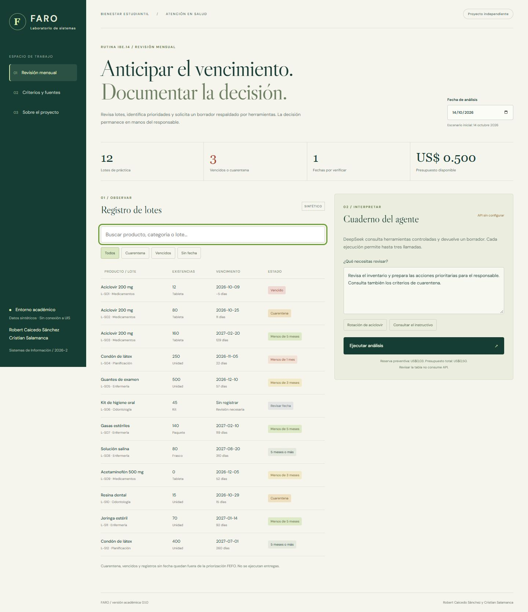
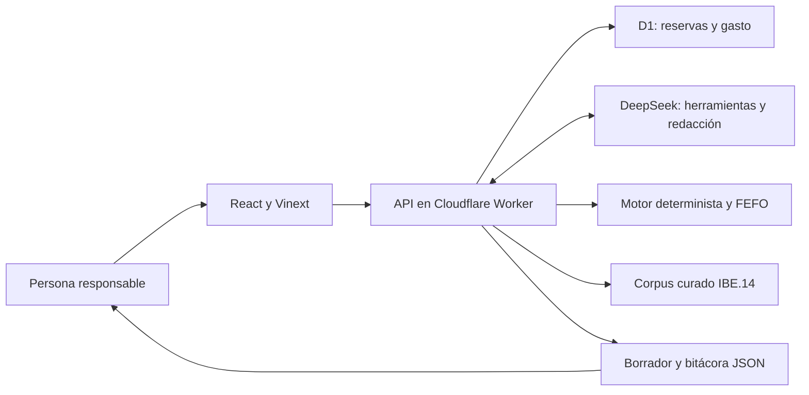

# FARO

**Agente para preparar revisiones mensuales de vencimientos con herramientas controladas y evidencia verificable.**

FARO combina un motor determinista para analizar lotes con un modelo de lenguaje para redactar un borrador. El responsable revisa los resultados, consulta la fuente y descarga la bitácora de la ejecución.

Este proyecto académico utiliza **12 lotes sintéticos**. No se conecta con inventarios reales ni con sistemas de la Universidad Industrial de Santander y no ejecuta dispensaciones o movimientos de existencias.



*Captura histórica local del 14 de octubre de 2026. Los datos son de práctica y el indicador de API corresponde a esa sesión, no al estado actual del alojamiento.*

## Funcionalidades

- Clasificación por una fecha de revisión reproducible y detección de registros sin fecha.
- Búsqueda por productos, categorías y lotes, con normalización de tildes.
- Consulta de un corpus curado de IBE.14, con identificador y página.
- Priorización FEFO de lotes aptos, con exclusiones explícitas.
- Borrador del agente, bitácora de herramientas y descarga de evidencia JSON.
- Control persistente de presupuesto con reservas atómicas.

## Arquitectura



| Herramienta | Responsabilidad |
| --- | --- |
| `analyze_lots` | Clasificación del conjunto sintético con cálculos reproducibles. |
| `search_reference` | Recuperación léxica de secciones documentales con página. |
| `prioritize_fefo` | Ordenación de lotes aptos y detalle de exclusiones. |

El servidor valida los argumentos y rechaza operaciones fuera del catálogo. Una ejecución admite hasta tres llamadas al proveedor. El modelo no puede alterar los cálculos ni escribir movimientos de inventario.

## Tecnologías

React, TypeScript, Vinext, Tailwind CSS, Cloudflare Workers, D1 y DeepSeek Tool Calls. Las pruebas usan Node.js y Python con SQLite para comprobar reservas concurrentes.

## Ejecución local

Requisitos: Node.js 22.13 o posterior y npm. Python 3 permite ejecutar la suite de presupuesto.

```sh
npm run install:ci
npm run dev
```

Abre la dirección impresa por el servidor, normalmente `http://127.0.0.1:5173/`. La tabla, los filtros y el motor determinista funcionan sin clave de IA.

El agente requiere una clave privada `DEEPSEEK_API_KEY` y D1 con las migraciones aplicadas. `.env.example` documenta la variable sin credenciales. Conserva los secretos en `.dev.vars` o en el gestor del alojamiento. Nunca los publiques en Git.

El starter simula identidad local mediante `/signin-with-chatgpt?return_to=/`. Esta identidad sirve para pruebas y no equivale a autenticación institucional. Consulta [la guía de entorno y migraciones](docs/DESARROLLO.md) para preparar el perfil local y D1.

## Pruebas

```sh
npm test
python -m unittest discover -s tests -p "test_*.py"
npx tsc --noEmit
```

La suite Node contiene 30 casos del motor y del agente y 20 del comprobador HTTP. Las pruebas del proveedor sustituyen el transporte y no consumen saldo. Python comprueba reservas concurrentes y condiciones del presupuesto. Ambas suites se ejecutan con los comandos anteriores.

| Verificación | Alcance |
| --- | --- |
| Fechas y FEFO | Umbrales, fin de mes, datos inválidos y exclusiones. |
| Ciclo agéntico | Herramientas, argumentos, límite de llamadas y errores. |
| Presupuesto | Reserva atómica, concurrencia y límites. |
| Comprobador HTTPS | Timeout, clasificación de respuestas y salida sin secretos. |

Dos consultas reales locales documentadas el 14 de octubre de 2026 comprobaron recuperación documental y revisión FEFO. Su costo total estimado fue US$0,003119. Estas comprobaciones no demuestran ahorro de tiempo ni aceptación del personal.

## Decisiones y límites

- Los cálculos críticos se ejecutan fuera del modelo. Se usan meses calendario y una política académica explícita ante diferencias entre gráfica y texto del instructivo.
- FEFO excluye vencidos, cuarentena, lotes sin fecha y existencias cero. A quince días o menos prevalece cuarentena.
- D1 conserva el contador global. El presupuesto inicial configurado es US$0,50, con reserva preventiva de US$0,03 por ejecución. Es una estimación, no una lectura del saldo del proveedor.
- Los errores conservan la reserva y no generan reintentos automáticos. D1 almacena metadatos mínimos, no la pregunta y respuesta completas.
- Hacer público el código no hace pública la aplicación alojada ni ofrece acceso a una clave. Una publicación financiada necesita acceso controlado.
- Esta edición no admite archivos adjuntos, no ejecuta análisis periódicos y no utiliza datos personales o clínicos.

La evaluación con personas y la revisión institucional de criterios quedan pendientes. Toda respuesta del agente es un borrador sujeto a revisión humana.

## Estructura

```text
app/                     Interfaz y API del servidor
lib/faro.mjs             Motor, herramientas y ciclo del agente
db/ y drizzle/           Esquema y migraciones D1
tests/                   Pruebas Node y Python
scripts/check-hosted.mjs  Comprobación puntual de respuesta HTTPS
docs/                    Documentación técnica y captura de interfaz
```

Los entregables del aula, secretos, bases de ejecución y archivos temporales quedan fuera de Git. El repositorio presenta la implementación y sus pruebas para revisión técnica.

## Autoría y referencias

Robert Caicedo Sánchez y Cristian Salamanca. Sistemas de Información 2026-2. Proyecto académico independiente, sin aprobación institucional implícita.

- [UIS IBE.14, semaforización de medicamentos y dispositivos médicos](https://www.uis.edu.co/intranet/calidad/documentos/bienestar_estudiantil/instructivos/IBE.14.pdf), versión 02, consultado el 14 de octubre de 2026.
- [DeepSeek Tool Calls](https://api-docs.deepseek.com/guides/tool_calls/).
- [Vinext](https://github.com/cloudflare/vinext), base del entorno de aplicación.

Las dependencias y componentes de terceros conservan las licencias y atribuciones incluidas en el proyecto.
